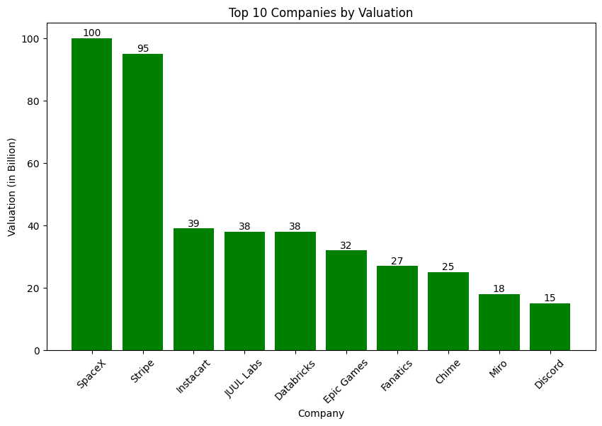
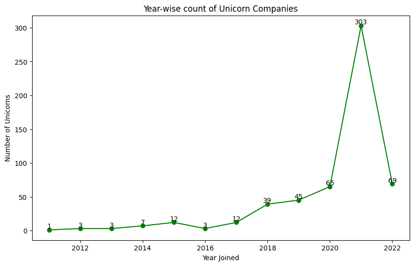
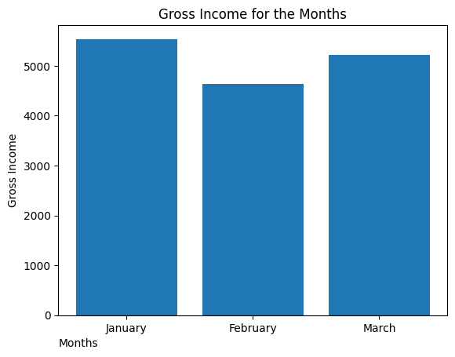
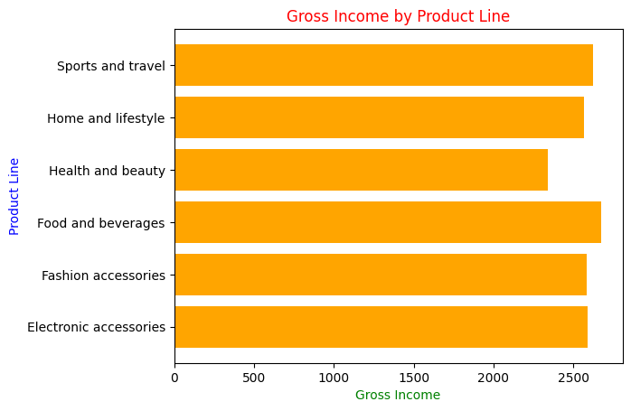

# Exploratory Data Analysis with Python

Data cleaning, analysis and visualisation projects using Python, pandas, NumPy, Matplotlib and Seaborn in Jupyter Notebook. All datasets are public.

## Projects

### 1. US Unicorn Company Analysis
**Notebook:** [Unicorncompanies[USA].ipynb](./Unicorncompanies%5BUSA%5D.ipynb)

**Question:** Which US startups became unicorns, how quickly, and in which industries?

**Dataset:** Global unicorn company dataset ([source: add link]), focusing on the 562 US companies.

**What I did:**
- Cleaned the data and standardised monetary values and dates
- Calculated time taken to reach unicorn status
- Visualised company counts, valuations and industry totals

**Key findings:**
- New unicorns jumped from 107 in 2020 to 507 in 2021 (global)
- 303 US companies reached unicorn status in 2021
- Fintech had the highest combined valuation among them (US$196B), narrowly ahead of internet software and services (US$189B)
- SpaceX (US$100B) and Stripe (US$95B) are far ahead of every other company

---

### 2. Retail Sales Analysis
**Notebook:** [DataAnalysisInJupyter1st.ipynb](./DataAnalysisInJupyter1st.ipynb)

**Question:** Which products and months drive gross income?

**Dataset:** 1,000 retail transactions covering January to March ([source: add link]).

**What I did:**
- Cleaned, validated and aggregated the transactions
- Analysed sales, profitability, customer segments and product performance
- Visualised monthly and product-line trends

**Key findings:**
- January had the highest gross income of the three months
- Food and beverages was the top product line and health and beauty the lowest, but all six lines were close together

## Tools
Python · pandas · NumPy · Matplotlib · Seaborn · Jupyter Notebook

## Contact
Sudin Giri · [LinkedIn](https://www.linkedin.com/in/sudin-giri-995a84226/) · sudingiri4@gmail.com
